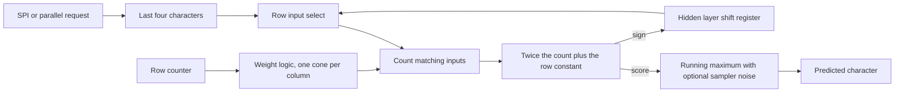

# Heddle: a language model with its weights hardwired as logic

Heddle is an experimental Tiny Tapeout tile for IHP SG13G2. It holds a small
character-level language model whose 18,432 weights are constants in the
chip's logic. There is no weight memory to load: the fabricated mask is the
model. A host pushes characters in and reads predicted characters out over SPI.

**What it is not.** The tile produces word-like text. It cannot chat, answer
questions or reason, and no shuttle slot is large enough for a model that can.
The [sizing study](scaling.md) works through what a 16-billion-parameter
version would take, and the [host card](card/README.md) shows the PCI Express
side of the concept.

Prompted with `the board ` and with its sampler on, the reference model
continues:

```text
pived inclenger pale refscadm fochorked dinists, had ox erorutch thad vals gonor cared usensefgeres the
```

Run `python asic/heddle/heddle.py --prompt "the board "` from the repository
root to generate text with the same integer arithmetic the chip uses.

## How the hardware works



- One clock evaluates one neuron. A token takes 176 clocks, one per row of the
  network (96 + 48 + 32).
- Every weight is −1, 0 or +1 and every hidden unit outputs a sign. A weight
  passes its input bit, passes the inverted bit or contributes nothing, so the
  datapath has no multiplier. A row's value is twice the number of matching
  inputs plus one signed constant per row.
- The weights are case-statement constants generated from `model.json`.
  Synthesis turns them into gates. Each of the 128 datapath columns has its own
  weight logic so that placement can keep it beside the bit it feeds.
- Output rows feed a running maximum. With the sampler on, each score receives
  noise from a 31-bit shift-register generator through a 32-entry table of
  Gumbel quantiles. Taking the maximum then draws a character in proportion to
  the model's probabilities instead of always choosing the likeliest one.
  Sampling is deterministic for a given seed sequence.

## The model

| Property | Value |
|---|---|
| Alphabet | 32 symbols: space, `a` to `z`, period, comma, hyphen, `0` for any digit run, newline |
| Input | the last 4 characters, one-hot |
| Layers | 128 → 96 → 48 → 32, ternary weights, sign activations |
| Weights | 18,432, of which 13,267 are non-zero |
| Training text | prose from this repository's Markdown at commit `a2f3e5a`, 1.05 million characters |
| Held-out set | every tenth 2,000-character block of each file, 55,528 predictions |

| Predictor | Bits per character on the held-out set |
|---|---:|
| Letter frequencies only | 4.38 |
| Previous character table | 3.62 |
| **Heddle, integer inference** | **2.96** |
| Previous two characters table | 2.88 |
| Previous three characters table | 2.19 |

Lower is better. The tables were fitted on the same training text. Heddle
lands just short of a two-character lookup table, which sets the honest
expectation for its output. Three training seeds gave 2.96, 2.99 and 2.96; the
committed model is the best of them, chosen on the held-out set, so that
figure is slightly optimistic. A full-precision network of similar size with
the same four-character context reached 2.28 in a shorter run, so ternary
weights and sign units cost about 0.7 bits per character at this scale.

`train.py` reproduces the procedure with NumPy alone. Floating-point training
is not bit-identical across machines, so `model.json` is the authority.

## Host interface

Both ports reach the same core. Requests arriving while the core is busy are
dropped and reported. All inputs are synchronized to the tile clock.

| Pins | Function |
|---|---|
| `uio[0]`, `uio[1]`, `uio[2]`, `uio[3]` | SPI chip select (active low), MOSI, MISO, clock. Mode 0, most significant bit first. MISO is driven only while selected |
| `ui[4:0]`, `ui[5]`, `ui[6]` | Parallel token in, go strobe (rising edge), and push (high) or feed back the last result (low) |
| `ui[7]` | Sampler enable. The SPI configure command sets the same option |
| `uo[4:0]`, `uo[5]`, `uo[6]`, `uo[7]` | Token out, result valid, busy, and a bit that toggles per completed result |

Each SPI byte is one command. The byte shifted out at the same time is the
status as it stood when that byte began.

| Command byte | Effect |
|---|---|
| `001ttttt` | Push token `t` into the context and predict the next one |
| `010xxxxx` | Step: push the last prediction and predict again |
| `011xxxxx` | Clear the context, the result and the sampler state |
| `100sssss` | Stir five bits into the sampler generator |
| `101xxxxe` | Set the sampler enable to `e` |
| anything else | Read status only |

Status is `{busy, valid, overrun, token[4:0]}`. Overrun reports a dropped
request and clears when read at the start of a frame.

Timing rules for a host:

- Keep the SPI clock at or below one eighth of the tile clock, and wait four
  tile clocks after selecting the chip before the first clock edge.
- A prediction is ready 176 tile clocks after its request is accepted. Poll
  the busy bit.
- On the parallel port, hold the token and push pins stable from two clocks
  before the go edge until busy rises.

## Verification

`sh asic/heddle/check.sh` needs Python 3.10 or later, Icarus Verilog and Yosys.

| Check | What it establishes |
|---|---|
| `test_heddle.py` | Reference arithmetic equals a plain ternary dot product; sampler never reaches its stuck state; both host ports return the reference tokens in the pin model; latency is exactly one clock per row |
| Weight readback | Every row of the generated weight logic equals `model.json` bit for bit, including the row constants and layer flags |
| Row-level simulation | 246,928 internal row values across 1,403 random requests equal the reference, followed by the chosen token |
| Pin replay, RTL | 18,114 clocks of SPI and parallel traffic, resets, overruns and an abandoned frame match the pin model on every output pin |
| Pin replay, gates | The same 18,114 clocks on the Yosys gate netlist |

As a control, a model with a single flipped weight was built into the logic
and checked against the unmodified vectors. All three simulator checks failed.
The readback named the exact row. The pin replay did not notice until clock
16,126, which is why the row-level check exists.

## Size

Mapped to the IHP SG13G2 typical-corner library with Yosys and ABC, the tile
is 12,784 cells and 139,873 µm². Set `HEDDLE_LIBERTY` to that library's path
to reproduce the figure with `check.sh`. The slot size and the layout results
are in [silicon/README.md](silicon/README.md).

## Limits

- Simulation and synthesis only. No sample has been fabricated or measured.
- The model has a four-character memory and no notion of words or meaning.
- Timing is constrained at 25 MHz. Higher clock rates are untested.
- The sampler's table approximates the intended distribution with 32 levels.
  Its statistical fidelity has not been measured.
- The asynchronous host inputs rely on two-stage synchronizers. Metastability
  rates have not been analyzed.
