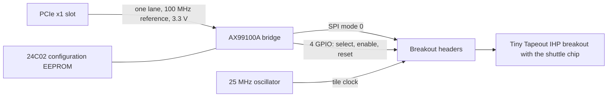

# Heddle PCIe host card

A PCI Express x1 add-in card that lets a PC talk to the [Heddle tile](../README.md).
The card is a **review draft**. Circuit Weaver validates the design and
generates its schematic. No board has been laid out, and the open items below
must be closed against vendor documents first.



A shuttle tile cannot contain a PCI Express transceiver, so a commodity bridge
terminates the lane. The shuttle chip arrives soldered to Tiny Tapeout's
breakout board, which plugs into two board-to-board headers on this card.

## Files

| File | Contents |
|---|---|
| `heddle_card.yaml` | Design spec: parts, nets, explicit no-connects |
| `components.json` | Pin data for the parts Circuit Weaver does not ship |
| `kicad/` | Generated hierarchical schematic, symbol library and design report |

## Signal map

| Card net | Bridge pin | Breakout header pin | Tile pin |
|---|---|---|---|
| `HEDDLE_CS_N` | 34 (SS0) | J2-5 | `uio[0]` |
| `HEDDLE_MOSI` | 32 | J2-7 | `uio[1]` |
| `HEDDLE_MISO` | 33 | J2-9 | `uio[2]` |
| `HEDDLE_SCK` | 31 | J2-13 | `uio[3]` |
| `TT_CTRL_ENA` | 51 (GPIO0) | J3-46 | shuttle mux enable |
| `TT_CTRL_SEL_INC` | 52 (GPIO1) | J3-47 | shuttle mux address increment |
| `TT_CTRL_SEL_RST_N` | 59 (GPIO6) | J3-43 | shuttle mux address reset |
| `TT_RST_N` | 60 (GPIO7) | J2-53 | `rst_n` |
| `TT_CLK` | from X1 through 33 Ω | J2-57 | `clk` |

The tile's parallel inputs `ui[7:0]` and the spare `uio[7:4]` are tied to
ground. The SPI port provides every function, including the sampler enable.
The tile outputs `uo[7:0]` are not connected on this revision.

To select the project, the host pulses `TT_CTRL_SEL_RST_N` low, pulses
`TT_CTRL_SEL_INC` once per count of the project's shuttle address, then raises
`TT_CTRL_ENA`. The address is assigned when the shuttle is built.

## Reproduce

Run from the repository root. The spec names its parts file relative to the
working directory.

```sh
circuit-weaver validate asic/heddle/card/heddle_card.yaml
circuit-weaver generate asic/heddle/card/heddle_card.yaml --output <new-directory>
```

The spec sets `auto_repair: false`. With repair enabled the tool did not
recognise two discrete pull-up resistors on the configuration bus and added
its own pull-ups to the 1.0 V rail, which also made validation pass. The
pull-ups are now declared as an I2C pull-up block on 3.3 V. The generator
still adds one default bypass capacitor per powered part, six in total, on top
of the decoupling listed in the spec.

| Stage | Result in this revision |
|---|---|
| `validate` | Passes with no findings in any category, with automatic repair off |
| `generate` | Writes the KiCad schematic. Its report marks the result unverified because no KiCad was available to load it or run ERC |
| ERC, PCB build, placement, routing | Not run. They need KiCad 8 or later |

## Open items before layout

Each of these is a fact the available documents did not settle. The pin
numbers and names come from the AX99100A datasheet V1.04 and from the Tiny
Tapeout multiplexer and breakout repositories.

1. **Bridge core supply.** The datasheet states single-supply operation with
   the internal 1.0 V regulator on `VO10`. The wiring from `VO10` to `VCCK`
   and `VCC10A_AUX` is shown only in ASIX's reference schematic, which
   requires a login. The spec ties all three together.
2. **Strap resistor values.** `CHIP_MODE[0]` (pin 54) is pulled down to select
   the two-serial-plus-SPI mode. The datasheet gives no value; the spec uses
   4.7 kΩ. Pin 53 selects auxiliary-power detection; the spec pulls it down
   because the card takes no `+3.3Vaux`.
3. **Configuration EEPROM.** The datasheet lists an EEPROM as required for
   this mode. Its contents must come from ASIX's tool.
4. **Unused bridge pins.** Modem-status inputs are tied to ground and other
   unused pins are left open. Confirm against the reference design.
5. **Breakout +5 V pins.** J3 pins 2 and 4 are left open. The breakout's
   regulators run from 3.3 V in its netlist; whether anything on it needs 5 V
   was not confirmed. The slot provides no 5 V rail.
6. **Header orientation.** Pin functions were read from the breakout's own
   connectors. Pin numbering on the mating headers and their spacing must be
   copied from Tiny Tapeout's demo board.
7. **High-speed layout.** The lane and reference clock need controlled
   impedance, length matching and the 100 nF transmit capacitors close to the
   edge fingers. Circuit Weaver does not verify any of that. The card
   electromechanical specification was not available, so finger plating,
   bevel and outline dimensions are also unchecked.
8. **JTAG fingers.** They are left open. Confirm whether the host chain
   expects `TDI` joined to `TDO`.
9. **Host software.** Mainline Linux recognises the bridge's serial and
   parallel functions only. SPI and GPIO need ASIX's out-of-tree driver, which
   is labelled for kernels up to 6.8.
10. **Shuttle limits.** No clock or pin-speed limit is published for IHP
    shuttle chips. The 25 MHz clock matches the tile's timing constraint. The
    SPI clock must stay at or below one eighth of it.
