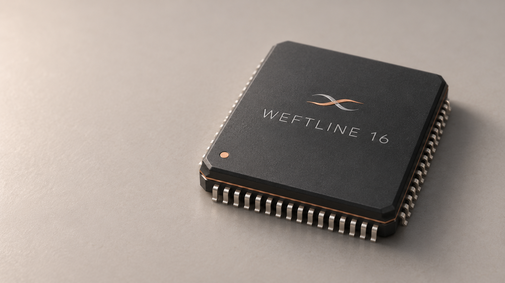
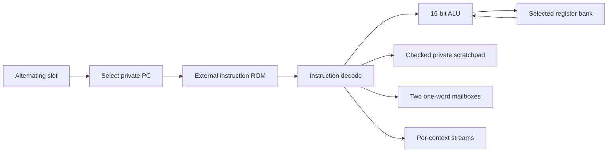

# Weftline 16 embedded control processor



Weftline 16 is the product name for the Slot16 processor. The two threads in the emblem represent its alternating execution slots. The image shows a proposed package appearance. Physical packaging and pin assignment are open design decisions.

Run `python asic/slot16/weftline.py` from the repository root to boot the quadrature encoder and diagnostic firmware on the [virtual board](virtual-board.md).

Slot16 runs a control loop and a service task on one 16-bit integer datapath. Each task owns every second clock edge, a private data bank and one input/output stream. The core suits small, fixed firmware images such as a sampled-data controller that forwards selected readings to telemetry. An integrator supplies the program ROM, stream buffers and peripherals.

The [ISA verification and controller report](validation.md) includes the assembler, independent simulator, formal properties and a measured filter/telemetry comparison with PicoRV32. Both met the 64-clock benchmark deadline.

## Design choices

| Problem in a conventional small controller | Slot16 mechanism | Cost or limit |
|---|---|---|
| Interrupt work or a software task switch can move a control-loop deadline. | A hardwired phase bit alternates between two resident contexts. A ready sequence of N instructions takes exactly 2N clocks from the start of its first slot to the start of its next slot after completion. | Each task gets at most half the issue bandwidth, even with an idle peer. An I/O or mailbox dependency can wait indefinitely. |
| Two firmware tasks with unrestricted access to the same SRAM can overwrite each other's state. | Every data address includes a hardware-selected bank bit. A widened range check faults the issuing task before an invalid load or store can commit. | Each task gets 64 words. Bulk transfers require copying. A bug can still corrupt the issuing task's own bank. |
| Polling an input consumes instructions and samples the device only once per poll loop. | A blocking input instruction tests availability on every owned edge. A full/empty mailbox provides one word of buffering in each direction. | Blocked slots still use clock cycles. Bidirectional protocols need a progress rule to prevent deadlock. |

These techniques have precedents. FlexPRET demonstrates fine-grained multithreading for timing isolation. XMOS provides hardware channels for communicating tasks. RISC-V PMP offers programmable protection regions when a system needs flexible sharing. Slot16 specializes these choices for exactly two tasks with a fixed scratchpad map and a small verification surface. A RISC-V implementation retains an established compiler ecosystem, while Slot16 firmware currently uses hand-encoded words. [FlexPRET](https://www2.eecs.berkeley.edu/Pubs/TechRpts/2015/EECS-2015-181.html), [XMOS programming model](https://www.xmos.com/documentation/XM-014363-PC/html/prog-guide/quick-start/prog-model.html), [RISC-V machine specification](https://docs.riscv.org/reference/isa/priv/machine.html)

## Execution and integration contract



- The first rising edge after synchronous reset deassertion belongs to context 0. Context 1 owns the next edge. A wait, halt or fault always leaves the peer's edge available.
- Each context has eight writable 16-bit registers, an 8-bit word PC, 256 instruction words and 64 data words. A 9-bit combinational ROM address concatenates context and PC. Integration requires memory and decode to settle within one clock. The ROM input has no wait states.
- At an owned edge, one instruction retires, waits or faults. Retirement updates the PC and commits all effects together. A waiting instruction keeps its PC and has no architectural side effects. A fault freezes its PC and sets the context's sticky fault bit. HALT retires once, advances the PC and sets the sticky halt bit. Both states require reset to exit.
- Only the issuing bank is addressable. The effective data address adds an unsigned 16-bit base to a signed displacement at extended precision. Values outside 0 through 63 fault. Scratchpad contents are unspecified at power-up and retained across reset. Firmware must initialize every word it reads. Reset zeros both PCs and register files, empties both mailboxes, and clears halt and fault status.
- One data word crosses between tasks when SEND retires into the peer's empty mailbox. RECV consumes exactly one word from the local mailbox. If a waiting peer is at RECV, it can consume the new word on the following edge. A stopped peer can leave a sender blocked indefinitely.
- External streams use **slot-qualified strobes**. Sample context `i` on a rising edge with `in_ready[i] && in_valid[i]` or `out_valid[i] && out_ready[i]`. Input data for context 0 occupies bits 15–0 and for context 1 bits 31–16. The producer holds its word and valid until accepted. The shared 16-bit output bus carries the word for the strobed context. While an output waits, the core reoffers it on each owned slot. An endpoint requiring continuous valid must use a holding register. All streams use the core clock. Asynchronous sensors require synchronization and buffering outside the core.
- `retire` is a pre-edge strobe for the instruction at `imem_addr`. Status pins expose halt and fault per context. There is no interrupt entry, preemption, cache, speculation, MMU or privileged execution in this revision. Private banking covers architectural accesses through this core. Debug, DMA, physical leakage and board-level isolation require separate analysis.

## Instruction encoding

Each ROM word is 16 bits. Bits 15–12 select the opcode, 11–9 select register D, and register forms use 8–6 for S. Immediate forms use bits 8–0 as a signed two's-complement value. Memory forms use bits 5–0 as a signed displacement. Unused fields are ignored. Arithmetic wraps modulo 65536 and PC arithmetic wraps modulo 256. The ROM interface transfers whole instruction words.

| Hex | Instruction | Effect on retirement |
|---|---|---|
| 0 | HALT | Stop this context. |
| 1 | LDI D, imm9 | Write the sign-extended immediate to D. |
| 2, 3 | ADD D, S / SUB D, S | Add S to D or subtract S from D. |
| 4, E | XOR D, S / AND D, S | Write the bitwise result to D. |
| 5, 6 | LD D, [S + disp6] / ST D, [S + disp6] | Load into D or store D in the private data bank. Invalid address faults. |
| 7 | BNZ D, rel9 | If D is nonzero, branch to PC + 1 + rel9. |
| 8, 9 | SEND D / RECV D | Send D to the peer, or replace D with the received word. Wait on full or empty respectively. |
| A, B | IN D / OUT D | Consume a word from the local input, or publish D to the local output. Wait for transfer. |
| C | VALID D | Write 1 if local input valid is asserted, otherwise 0. Leaves input pending. |
| D | SHL D | Shift D left one bit, zero-filling bit 0. |
| F | Reserved | Fault this context without retirement. |

A two-word transfer loop can use `IN r0` (0xA000) followed by `OUT r0` (0xB000) as its body. For a continuous loop, first load a separate register with one and add a taken BNZ back to IN after OUT. The testbench contains executable images for polling, arithmetic, checked loads and stores, backpressure and two-way messaging.

## Reproduce the measurements

From the repository root, with Icarus Verilog and Yosys including ABC on PATH, run the following in a POSIX shell.

```sh
sh asic/slot16/check.sh
```

The benchmark drives a single input word at each of six consecutive arrival edges (16–21) and holds the output ready. It executes the same workload under four peer conditions (halted, writing its private bank, waiting on an empty mailbox, and faulted). The paired baseline is a software polling loop on the same RTL. That keeps the clock, datapath and input timing identical. The test checks the output payload, edge and instruction count on all 48 runs.

| RTL input-to-output result | Blocking IN then OUT | Software status/branch polling |
|---|---:|---:|
| Earliest to latest response across six arrival phases | 2–3 clocks | 6–11 clocks |
| Output edge for arrival on edge 20 | 22 | 26 |
| Retired instructions through output for arrival on edge 20 | 2 | 14 |
| Difference in output edge across four peer conditions at fixed arrival | 0 clocks | 0 clocks |

The zero peer-dependent variation comes from slot ownership in both programs. The additional response improvement comes from the instruction used to wait. The comparison measures this firmware and interface at RTL. Real interrupt latency, physical clock speed, power and performance against commercial cores remain unmeasured.

### Existing-core comparison

A second bench runs the same echo on the upstream PicoRV32 RTL in its default configuration. Its two-instruction body uses a blocking memory-mapped load followed by a store. This gives the baseline a zero-wait instruction ROM, an always-ready output, no competing task and no polling penalty. In all six arrival phases the processor was already waiting for input. It delivered the word **5 clocks** after arrival, compared with **2–3 clocks** for Slot16. PicoRV32 had zero phase-dependent jitter in this test. Slot16 spent fewer clocks on the transfer and reserved the alternate edges for its peer. The two cores have different datapaths, buses and ISAs. Elapsed nanoseconds require timing closure for both designs. [PicoRV32 source revision](https://github.com/YosysHQ/picorv32/tree/ef203c2b0a3fb793280f5114941416c425c5b461)

To repeat the optional baseline on a machine with Git and Icarus Verilog, run these commands from the repository root. They place the upstream source and simulation binary in a temporary directory.

```sh
benchdir=$(mktemp -d)
git clone -q https://github.com/YosysHQ/picorv32.git "$benchdir/picorv32"
git -C "$benchdir/picorv32" checkout -q ef203c2b0a3fb793280f5114941416c425c5b461
iverilog -g2012 -s bench_picorv32 -o "$benchdir/echo" \
    "$benchdir/picorv32/picorv32.v" asic/slot16/bench_picorv32.sv
vvp "$benchdir/echo"
```

### Synthesis result

The same command runs generic synthesis and `check -assert`. With Yosys 0.23 and its default ABC mapping, the core produced 8,081 generic cells, including scratchpad storage implemented in flip-flops. Instruction ROM and stream adapters are external to this count. Cell counts depend on tools and mapping. This result establishes logic synthesizability. A standard-cell area or frequency estimate requires a technology library and timing constraints.

## Implementation plan and decision gates

| Stage | Work | Evidence needed to advance |
|---|---|---|
| Architecture prototype (in this directory) | Execute both firmware images, exercise every instruction class, sweep arrival phase, inject memory faults, fill/drain mailboxes and synthesize the core. | Reproduce the table above and pass the structural synthesis check. |
| ISA and protocol verification | Assemble firmware, compare each edge against an independent interpreter and prove transition properties for arbitrary state. | 13,400 matching edge traces, all legal opcode retirements and blocking/fault outcomes observed, and passing SAT assertions. |
| Representative controller | Run the two-tap filter and telemetry firmware on Slot16 and a control-priority PicoRV32 dispatcher with equivalent peripheral buffering. | Across 56 scenarios per core, Slot16 responded in 9–10 clocks and PicoRV32 in 30–64. Per-sample distributions, throughput and memory use are in the verification report. |
| ASIC feasibility | Choose a PDK and clock target, supply ROM and scratchpad implementations, and close the fetch/decode/load path. Compare flop storage against available memory macros. A synchronous macro may require a new pipeline and timing contract. | Library-mapped area including memories and adapters, setup/hold slack at chosen corners, activity-based energy per sample, and replay-equivalent outputs and bounds after mapping. |
| Physical prototype | Complete scan/reset strategy, I/O integration, floorplan, clock tree, routing and foundry signoff. Exercise stalls, resets and deadlines on hardware. | DRC/LVS and timing reports, test coverage, and measured response and energy before a silicon performance claim. |

If one task needs more than half the clock edges, more than 256 instruction words, or bounded progress despite an unresponsive peer, this revision misses that requirement. The workload experiment should settle those questions before investing in layout.
