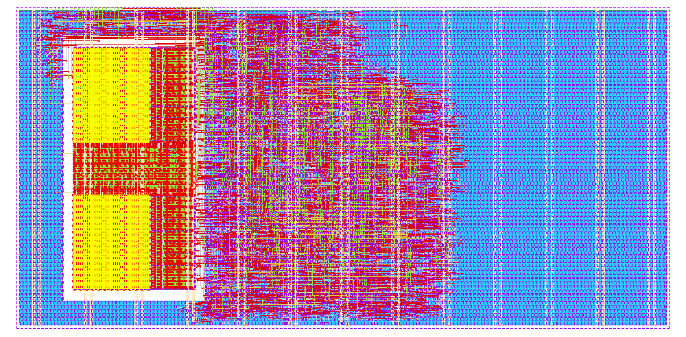

# Weftline 16 silicon tile

The tile implements both Slot16 contexts, their firmware ROMs, a single-port IHP
SRAM, and a synchronous pin interface for a 3×2 Tiny Tapeout SG13G2 slot. The
target is 25 MHz in a 636.96 × 313.74 µm boundary. The shuttle supplies the
pads, clock, reset, power and package. [Carrier memory guidance](https://tinytapeout.com/specs/memory/)



The extracted layout met the 40 ns clock constraint at all three characterized
corners. Worst setup slack was +20.550 ns and worst hold slack was +0.131 ns.
The post-route timing reports had zero slew, capacitance and fanout violations.
The pin replay matched the virtual board for 4,809 clocks on the routed
gate netlist. Timing comes from extracted static analysis. The replay uses
the functional standard-cell and SRAM models.

## Scratchpad

The two lanes each own 64 × 16 bits. A load or store presents one address on
its issuing edge. The upper address bits select the lane in hardware. The
256 × 16 macro has 128 unused rows. The result of a synchronous load enters
its destination register during the peer's slot and is ready for the owner's
next instruction. Stores, faults and warm reset preserve the architectural
behavior of the virtual board. Cold SRAM contents are unspecified.

A same-design synthesis control mapped the tile with ordinary register storage
to 207,418 µm². With the SRAM, the synthesized logic occupied 39,793 µm² and
the macro occupied 28,127 µm². These are pre-placement areas. Clock buffers,
routing space and filler cells change the final area. The hardening kit includes
nominal and slow SRAM Liberty views and a fast view at −55 °C. At the fast corner
the standard cells use −40 °C and the SRAM uses its supplied −55 °C view.
[PDK memory views](https://github.com/IHP-GmbH/IHP-Open-PDK/tree/22f43352dd8219f9007eb659e422e0d5fe28c5fb/ihp-sg13g2/libs.ref/sg13g2_sram)

## Bring-up

1. Enable the tile, hold `rst_n` low, set `ui[5]` high and supply at least
   one rising clock edge. Release reset and keep clocking. The boot strap
   selects both diagnostic images. Changing it while running has no effect.
2. Within 6,000 clocks both halt bits should be high and both fault bits low.
   Select the lane with `ui[4]` and byte with `ui[3]`. Each lane should read
   `0x00a5`. A lane that detects a mismatch emits `0xffff` and halts.
   The test writes an address-dependent pattern, checks and inverts it in
   descending order, then checks the inverse in ascending order. This covers
   the 128 architecturally reachable words.
3. Reset again with `ui[5]` low to boot the encoder and diagnostics. Present
   synchronous A/B samples on `ui[1:0]` and hold `ui[2]` high with data stable
   until a rising edge with `uio[0]` high. Each accepted sample eventually
   produces a lane-0 position and a lane-1 error count. An external mechanical
   encoder needs synchronization and debouncing before these pins.

| Pins | Meaning |
|---|---|
| `uo[7:0]` | Selected byte of the selected lane's last completed result |
| `uio[0]` | Lane 0 sample ready |
| `uio[2:1]` | Result strobes for lanes 1 and 0. The latch changes at the rising edge. |
| `uio[4:3]`, `uio[6:5]` | Halt and fault flags respectively, lane 1 in each upper bit |
| `uio[7]` | Latched boot mode |
| `ena`, `rst_n` | Disabling the tile turns off bidirectional output drivers immediately. A clock edge with disable or reset active resets the CPU and result latches. |

## Reproduce

From the repository root, run `python asic/slot16/weftline.py --scratch-test --scratch-seed 42`
to boot the diagnostic. Run `sh asic/slot16/check.sh` with Python 3.10+, Icarus
Verilog and Yosys for the portable RTL, firmware, pin replay and formal checks.

The following Linux shell commands produce a routed layout and replay both
firmware modes on its gate netlist. Choose a fresh build directory on each run.

```sh
work=$(mktemp -d)
git clone -q https://github.com/TinyTapeout/tt-support-tools.git "$work/tt"
git -C "$work/tt" checkout -q 7d2d2ef5261eb1df16d0bc342834d48a8a276881
docker run --rm -v "$PWD:/repo:ro" -v "$work:/work" --entrypoint sh \
  ghcr.io/librelane/librelane@sha256:f91b21d75f79871f9ccf37451020b5d2f7b3236881a997ff709c561e8280a30f \
  /repo/asic/slot16/silicon/harden.sh /work/build /work/tt
```

The `tt_submission` directory contains GDS, OASIS, LEF, gate Verilog, extracted
parasitics, PDK revision, build metadata and pin assignments. The run directory contains timing,
antenna, LVS, both DRC reports and an image streamed from the layout. Hierarchical
LVS treats the vendor SRAM as a macro. Magic's full-chip report is compared
rule by rule and coordinate by coordinate with the original vendor GDS at the
same orientation and placement. Any additional marker fails the build. KLayout
checks the entire GDS. CI then runs the pinned shuttle precheck on the exported
layout. Silicon measurements require a fabricated sample.
[Shuttle precheck](https://github.com/TinyTapeout/tt-support-tools/tree/7d2d2ef5261eb1df16d0bc342834d48a8a276881/precheck)
