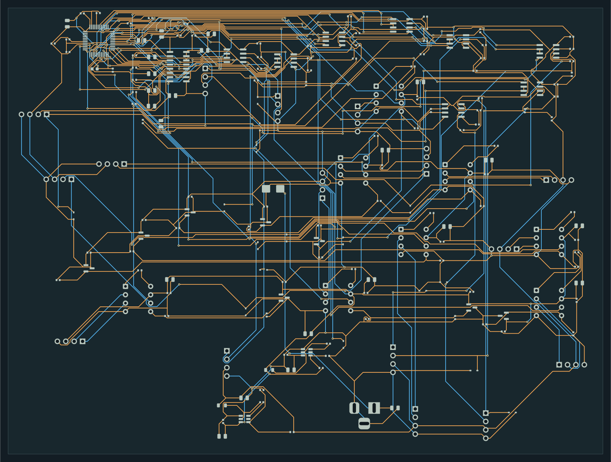
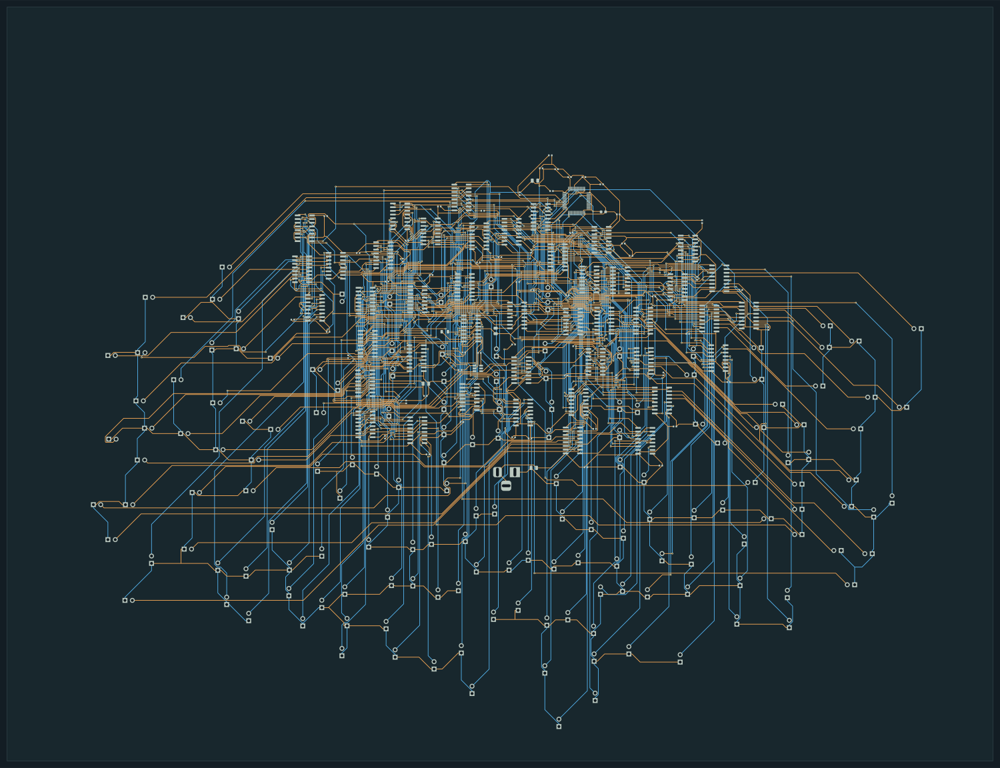
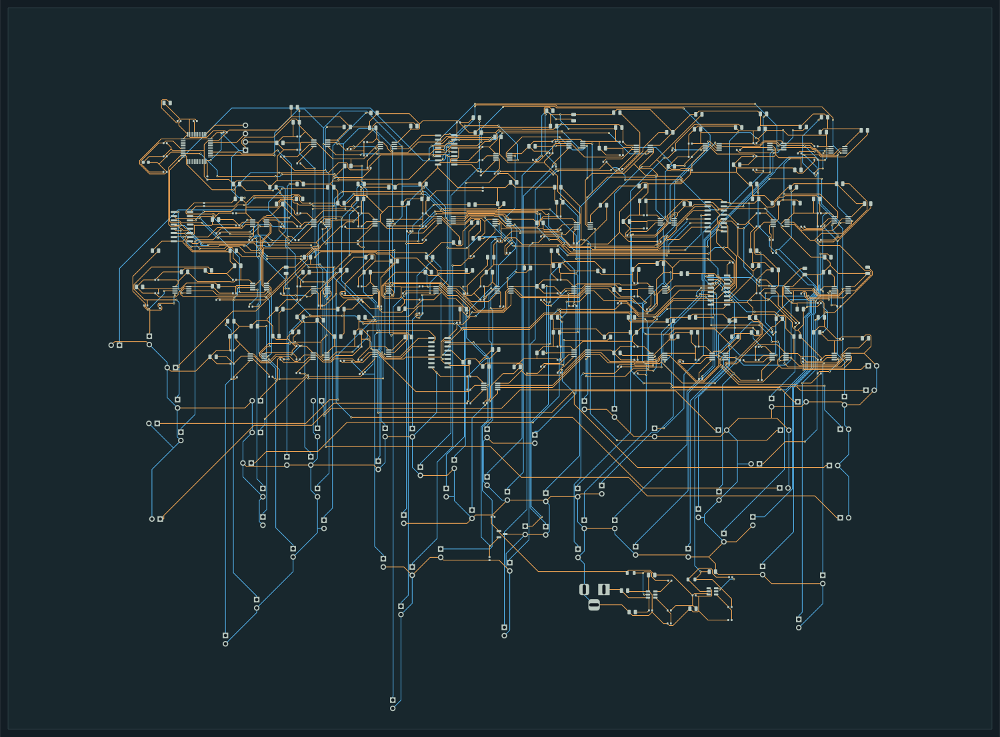

# KiCad routing samples

Open a **routed** board in KiCad 10 PCB Editor to inspect the copper, or use its
**placed** board to try a different routing policy on the same footprint and
reference-label positions. Keep each board beside its same-named `.kicad_pro`
so KiCad loads the original net classes. These are two-layer prototype layouts
for placement, routing and repair experiments.

| Board | What to inspect | KiCad files | Vias | Copper |
| --- | --- | --- | ---: | ---: |
| **Facility gateway** · 187 footprints | Eight analog acquisition channels share the board with RS-485 and CAN. The full and first-clean policies produced identical copper in all three paired runs. | [Placed](gateway/placed.kicad_pcb) · [Routed](gateway/routed.kicad_pcb) · [Project files](gateway/) | 214 | 10,328.81 mm |
| **Serial relay output card** · 268 footprints | Follow the register-to-driver-to-header routing on 160 coil channels. The pictured first-clean route used 19 more vias than its paired full-portfolio run. | [Placed](relay/placed.kicad_pcb) · [Routed](relay/routed.kicad_pcb) · [Project files](relay/) | 839 | 27,749.30 mm |
| **Analog setpoint card** · 438 footprints | Follow the shared SPI bus to 36 dual DACs and the filters serving 72 outputs. The saved partial below isolates one open on that bus. | [Placed](setpoint/placed.kicad_pcb) · [Routed](setpoint/routed.kicad_pcb) · [Project files](setpoint/) | 530 | 20,433.41 mm |

| Facility gateway | Serial relay | Analog setpoint |
| --- | --- | --- |
| [](gateway/routed.png) | [](relay/routed.png) | [](setpoint/routed.png) |

Orange traces are front copper and blue traces are back copper. Each preview
shows its linked routed file. The lengths above sum native track and arc
lengths on both layers. Each of these three files passed KiCad 10.0.4 DRC with
zero findings and passed its signal and return-path checks (43, 160 and 110
paths respectively).

## Replay a route

From the repository root, copy a placement and its project into an empty
working directory. This example uses Gateway. The study used KiCad 10.0.4
and Freerouting 2.5.0 with the following settings.

```sh
mkdir gateway-trial
cp samples/routing/gateway/placed.kicad_pcb gateway-trial/
cp samples/routing/gateway/placed.kicad_pro gateway-trial/
cd gateway-trial
circuit-weaver autoroute placed.kicad_pcb --routed-board result.kicad_pcb --attempts 3 --timeout 1800 --max-passes 20 --optimization-threads 0 --repair-open-connections --recovery-timeout 1800 --stop-at-first-clean
kicad-cli pcb drc --format json --severity-all --exit-code-violations -o result-drc.json result.kicad_pcb
```

For a full-portfolio comparison, repeat in a second empty directory with the
same inputs and omit `--stop-at-first-clean`. Independent runs can choose
different routes. The gallery preserves the representative first-clean outputs
from Gateway repeat 3, Relay repeat 1 and Setpoint repeat 3. The study reports
the medians across all three repeats. [Routing study and timings](https://github.com/mattpainter701/circuit-weaver/pull/63)
· [Tool setup](../../docs/routing-placement-search.md#tool-setup)

## Inspect the last Setpoint open

Open [last-open.kicad_pcb](setpoint/last-open.kicad_pcb) with its
[project settings](setpoint/last-open.kicad_pro). Run DRC and select the single
unconnected item to zoom to pad **U54.7** and the **F.Cu** track on
`SPI_MOSI`. This snapshot comes from repair of a partial session on the same
placement. It closed 107 of 108 opens. The independent clean route in the
gallery shows one way the full-board router connected that net.
[Compare the two SPI_MOSI routes at the same scale](setpoint/spi-mosi.svg)

From the repository root, replay stock repair with the remaining time budget.
The command writes fresh DRC and recovery evidence into a new directory.

```sh
python benchmarks/general_scale/replay_routing_repair.py samples/routing/setpoint/last-open.kicad_pcb --output setpoint-replay --recovery-seconds 104.4 --pair-limit 0
```

The recorded baseline ended with one open and zero other DRC findings. The
replay output records the remaining opens and whether a clean board was
published. [Repair study](https://github.com/mattpainter701/circuit-weaver/pull/64)
· [Replay options](../../benchmarks/general_scale/README.md#replay-routing-repair)

The designs and path contracts come from Circuit Weaver's
[unseen-scale fixtures](../../benchmarks/unseen_scale/README.md).
[SHA256SUMS](SHA256SUMS) identifies the exact PCB and project files in this gallery.
